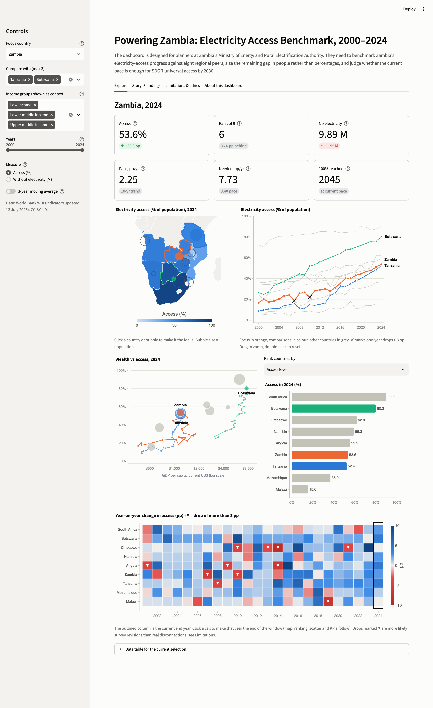

# Powering Zambia: Electricity Access Benchmark, 2000–2024

An interactive visual-analytics dashboard built for **CSC 6732 Data Visualisation, Assignment 4: Interactive Dashboard and Data Storytelling** (University of Zambia, MSc Data Science). It is built with Streamlit and Plotly.

> The dashboard is designed for planners at Zambia's Ministry of Energy and Rural Electrification Authority. They need to benchmark Zambia's electricity-access progress against eight regional peers, size the remaining gap in people rather than percentages, and judge whether the current pace is enough for SDG 7 universal access by 2030.



## What's inside

| Tab | Purpose |
|---|---|
| **Explore** | KPIs for the focus country plus five coordinated views: a map, a time series, a wealth-vs-access scatter, a ranking and a year-on-year anomaly heatmap. Clicking a country on the map, ranking or scatter makes it the focus. Clicking a heatmap cell jumps to that year. |
| **Story: 3 findings** | Three findings, each told as Context → Evidence → Insight → Implication → Recommended action. Every number is computed from the data at run time. |
| **Limitations & ethics** | Dataset limitations, uncertainty, missing data, bias, misleading readings, privacy, and the conclusions the dashboard *cannot* support. |
| **About this dashboard** | Users, questions, decisions, and each interaction with its analytical purpose. |

## Run locally

Use Python 3.11 or newer (developed on 3.13).

```bash
python3 -m venv .venv
.venv/bin/pip install -r requirements-dev.txt
.venv/bin/streamlit run app.py
```

Run the tests:

```bash
.venv/bin/pytest
```

## Deploy (Streamlit Community Cloud)

1. Push this repository to GitHub.
2. Go to <https://share.streamlit.io>, choose **Create app → Deploy a public app from GitHub**, and select the repo, the `main` branch and `app.py`.
3. Under *Advanced settings*, choose Python 3.12 or 3.13, then deploy. Dependencies come from `requirements.txt`.

## Project structure

```
app.py               Streamlit entry point: sidebar state, tabs, linked-view wiring
src/data.py          Load + clean the workbook, derived variables (people without power, pace, MA, anomalies)
src/charts.py        Plotly figure builders and the shared colour rules
src/story.py         The three storytelling findings (text + figures)
src/content.py       User/task statement, interaction-purpose table, limitations text
data/                World Bank WDI extract (9 countries × 2000–2024)
tests/               pytest checks on loading and derived variables
docs/screenshots/    Screenshots used in the report
```

## Data

World Bank, World Development Indicators (EG.ELC.ACCS.ZS, EG.FEC.RNEW.ZS, NY.GDP.PCAP.CD, SP.URB.TOTL.IN.ZS, SP.DYN.LE00.IN, SP.POP.TOTL), retrieved via the World Bank API and updated 13 July 2026. Licensed under [CC BY 4.0](https://datacatalog.worldbank.org/public-licenses#cc-by).

Cleaning follows the Assignment 1 audit:
- Namibia's ISO2 code `"NA"` is kept as text, and ISO3 is used as the key.
- `Region` and `Period start` are dropped.
- Renewables are not imputed after 2021.
